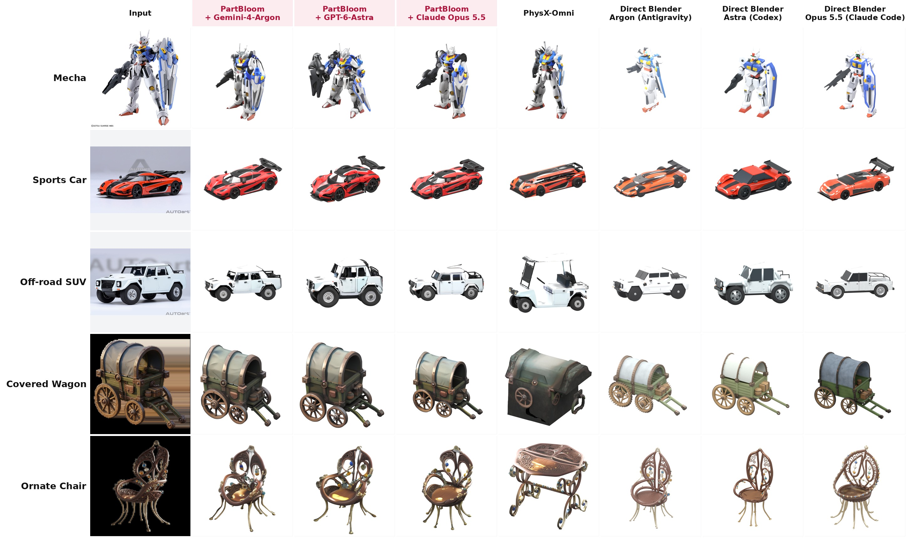
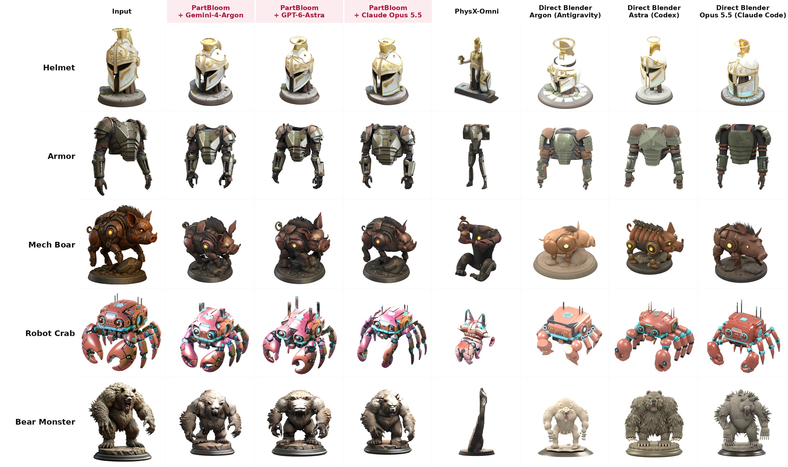
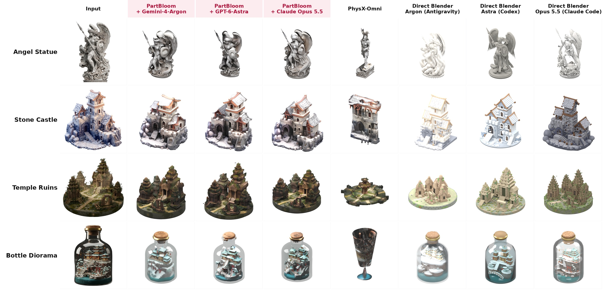
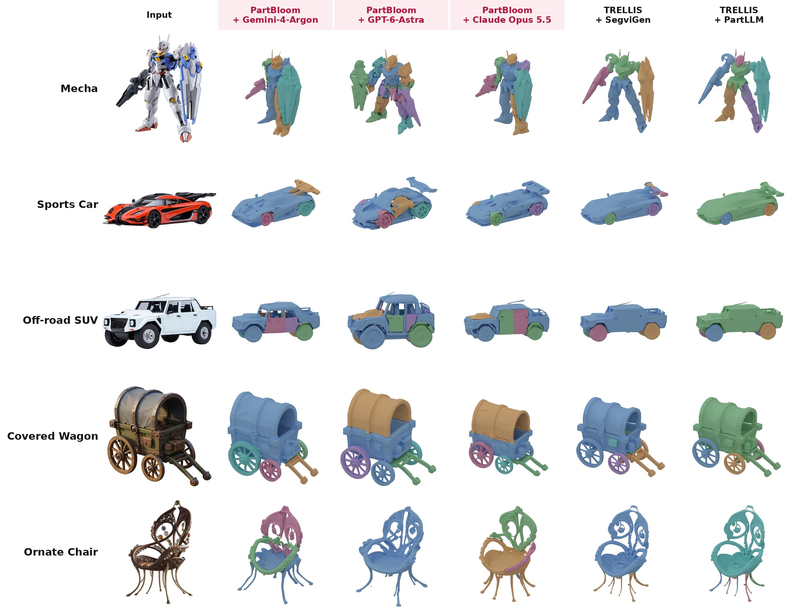
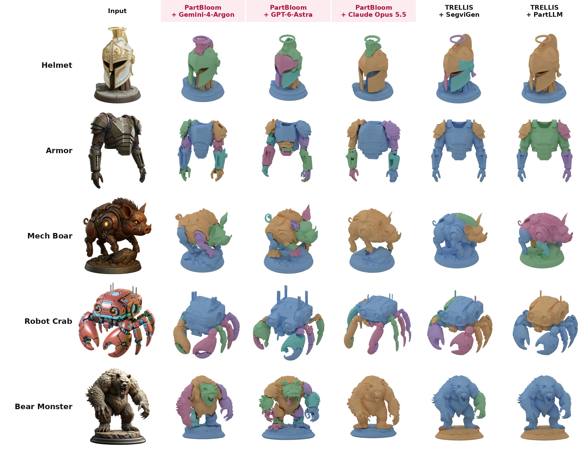
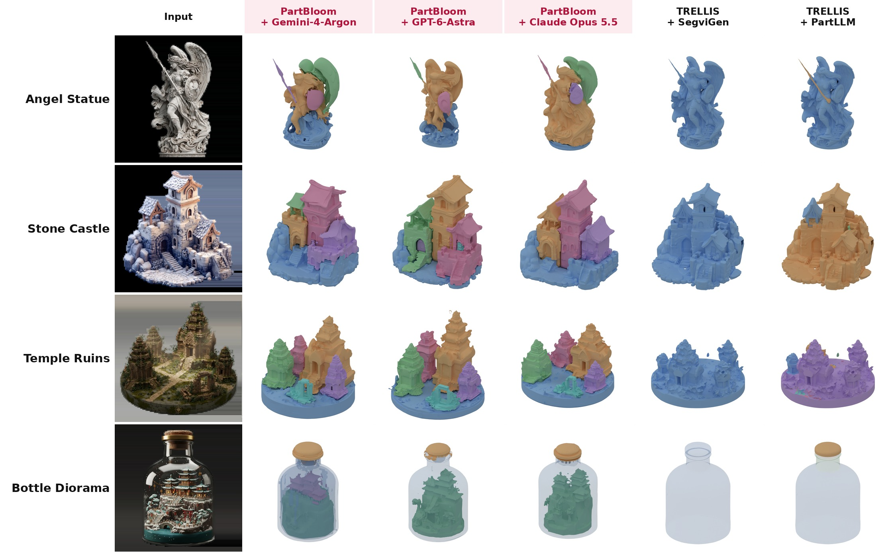
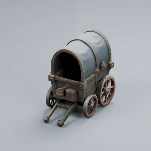
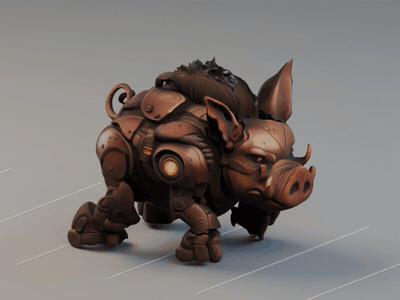
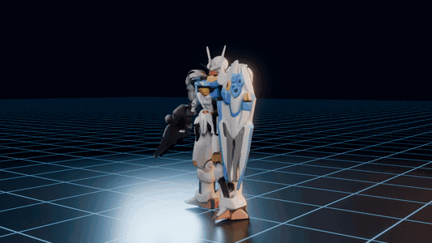

<div align="center">

# PartBloom

**Structure First. Details Bloom.**

</div>

PartBloom is an open-source framework that uses multimodal LLMs to construct part-level voxel proxies, then transforms them into detailed 3D assets through generative diffusion models.

The current release is the **TRELLIS1 version**.

## Overview

Given a single image, PartBloom works in two stages:

1. **Structure first: a multimodal LLM agent builds a part-level voxel proxy.**
   - A *Planner* looks at the image and chooses the parts. It splits by function and independent motion, and keeps small fixed attachments with the part they belong to.
   - A *Builder* edits a shared 64³ voxel canvas directly with `polygon`, `brush`, `move` and `clear` tools, one part at a time.
   - A *Reviewer* compares renders of the proxy with the input image. It triggers up to two whole-object repair rounds.
2. **Details bloom: a generative diffusion model turns the proxy into a detailed 3D asset.**
   - The proxy surface is dilated into a thin support band and encoded by the TRELLIS sparse-structure VAE. It is then partially noised (t = 0.65) and refined by 12 image-guided denoising steps (CFG 5).
   - Part labels are transferred to the refined structure. One structured latent (SLat) is sampled for the whole object.
   - Each part is decoded from its own slice of the shared SLat. This yields one mesh per part that stays consistent with the rest of the object.
   - Textures come from TRELLIS's own Gaussian decoder and texture baking. The output is a textured GLB for every part plus an assembled GLB.

The agent stage is model-agnostic. It talks to the LLM through protocol adapters (`responses`, `generate_content`, `anthropic`, `chat_completions`), so switching to another provider only takes a config change. Results below use Gemini-4-Argon (medium), GPT-6-Astra (medium) and Claude Opus 5.5 (high).

## Roadmap

| Phase | Milestone | Deliverables | Status |
| --- | --- | --- | --- |
| 🚀 M0 | Project launch | This repository and qualitative comparisons | ✅ Done |
| 🧩 M1 | TRELLIS1 version | MLLM part planning, voxel proxy tools, image-guided structure refinement, shared-SLat per-part decoding, and native texture export | ✅ Done |
| 📦 M2 | Code release | Pipeline code, prompts and configs | ✅ Done |
| 🌸 M3 | TRELLIS.2 version | Port the detail-blooming stage to the TRELLIS.2 backbone | 🔜 Planned |
| 🦴 M4 | Rigging | Skeletons, skinning and animation for part-level assets | 🚧 In progress |

> **Status legend:** ✅ Done · 🚧 Partial or in progress · 🔜 Planned

## Results

The benchmark has 14 single-image inputs: vehicles, mecha, creatures, statues, furniture, architecture and dioramas.

### Image-to-3D comparison

| Method | Description |
| --- | --- |
| PhysX-Omni | Official fine-tuned VLM predicts voxels, which are decoded by TRELLIS (seed 1) |
| Direct Blender | An agent looks at the image and writes Blender Python directly: Argon (Antigravity CLI), Astra (Codex), Opus 5.5 (Claude Code) |
| **PartBloom** | Ours, with Gemini-4-Argon (medium), GPT-6-Astra (medium) and Claude Opus 5.5 (high) |





### Part decomposition

Colors mark parts. PartLLM uses its general granularity.





### Rigging

PartBloom outputs one mesh per functional, independently moving part, so its assets can be rigged directly. Click a GIF for the full video.

| Covered Wagon: drive and steer | Mech Boar: run cycle | Mecha: shield charge |
| :---: | :---: | :---: |
| [](assets/rigging/covered_wagon.mp4) | [](assets/rigging/mech_boar.mp4) | [](assets/rigging/mecha.mp4) |
| PartBloom + Claude Opus 5.5 | PartBloom + GPT-6-Astra | PartBloom + Claude Opus 5.5 |

## Getting started

### Layout

```text
partbloom/
├── run.py              entry point
├── configs/            default parameters and an API config template
├── prompts/            Planner / Builder / Reviewer prompts and voxel tool schemas
├── pipeline/           agent, voxel engine, support band, guided refinement, decoding, texture export
├── tools/              part renderer, textured preview, agent log replay and recovery
└── tests/              CPU tests
```

### Setup

1. Clone the upstream code into `vendor/` at the repository root:
   - [PhysX-Omni](https://github.com/ziangcao0312/PhysX-Omni) → `vendor/PhysX-Omni` (provides the TRELLIS implementation)
   - [DINOv2](https://github.com/facebookresearch/dinov2) → `vendor/dinov2`
2. Download the weights into `weights/`:
   - [TRELLIS-image-large](https://huggingface.co/microsoft/TRELLIS-image-large) → `weights/TRELLIS-image-large`
   - `dinov2_vitl14_reg4_pretrain.pth` → `weights/dinov2/`
3. Create a GPU environment at `.venv/` that meets the TRELLIS requirements (CUDA, xatlas, nvdiffrast and the Gaussian renderer for texture export).
4. Install [Blender](https://www.blender.org/) 4.5 and put `blender` on `PATH`. It is used for part renders.
5. Install the CPU dependencies and check the setup:

```bash
pip install -r partbloom/requirements-cpu.txt
python partbloom/run.py doctor
python -m pytest partbloom/tests -q
```

Every resource path can be overridden with `--config my.json` (relative paths resolve against the repository root) or with the `AGENTVOXEL_VENDOR` and `AGENTVOXEL_WEIGHTS` environment variables.

### API

Copy `partbloom/configs/api.example.json` and point it at your provider:

```json
{
  "protocol": "responses",
  "base_url": "https://your-service.example/v1",
  "api_key_env": "AGENTVOXEL_API_KEY"
}
```

`protocol` is one of `responses`, `generate_content`, `anthropic` or `chat_completions`. The model is set with `--model` and the reasoning level with `--reasoning-effort`.

### Run

```bash
# Full pipeline: agent voxel proxy -> guided refinement -> per-part decoding -> textures
python partbloom/run.py run \
  --image path/to/image.png \
  --api-config my_api.json --model claude-opus-5-5 --reasoning-effort high \
  --out outputs/chair --gpu 0

# Individual stages
python partbloom/run.py coarse   --image IMG --api-config API --out OUT       # agent stage only
python partbloom/run.py refine   --source OUT/coarse --out OUT2 --gpu 0       # refinement from a voxel proxy
python partbloom/run.py redecode --source OUT/refined --out OUT3 --decode-mode joint --gpu 0
python partbloom/run.py texture  --source OUT/refined --out OUT/textured --gpu 0
python partbloom/run.py render   --source OUT/refined/objs --out parts.png
```

A full run writes `coarse/` (voxel proxy, prompts and API logs), `refined/` (refined structure, shared SLat and per-part meshes), `textured/` (per-part textured GLBs and `assembly_textured.glb`) and `parts.png`. Add `--resume` to skip completed stages of the same run.

## Coordinate convention

Voxel proxies use +X right, −Y forward and +Z up, on a 0..63 grid. Exported GLB files follow the standard Y-up convention.

## Acknowledgements

PartBloom builds on [TRELLIS](https://github.com/microsoft/TRELLIS). Baseline results use [PhysX-Omni](https://github.com/ziangcao0312/PhysX-Omni), SegviGen and PartLLM.
