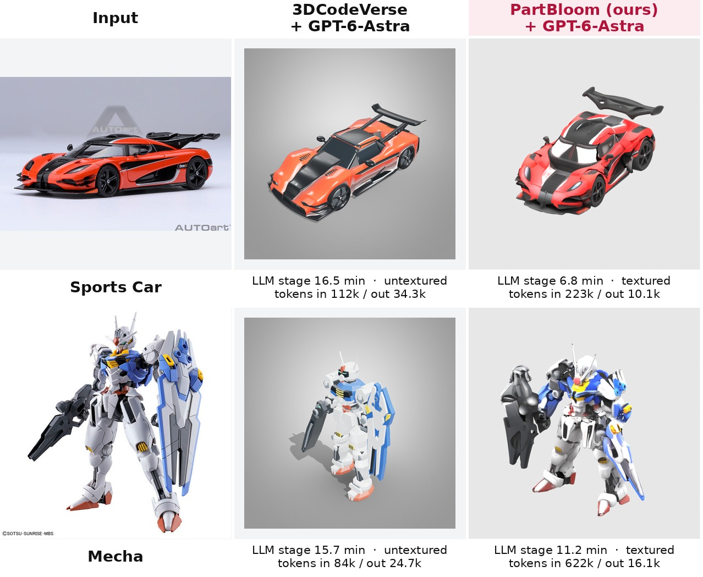

# PartBloom

**Structure First. Details Bloom.**

PartBloom is an open-source framework that uses multimodal LLMs to construct part-level voxel proxies, then transforms them into detailed 3D assets through generative diffusion models.

The current release is the **TRELLIS1 version**. A TRELLIS.2 version and rigging are planned.

## Overview

Given a single image, PartBloom works in two stages:

1. **Structure first: a multimodal LLM agent builds a part-level voxel proxy.**
   - A *Planner* looks at the image and chooses the parts. It splits by function and independent motion, and keeps small fixed attachments with the part they belong to. There are no category templates, so it doesn't assume a fixed layout for chairs, cars and so on.
   - A *Builder* edits a shared 64³ voxel canvas directly with `polygon`, `brush`, `move` and `clear` tools, one part at a time.
   - A *Reviewer* compares renders of the proxy with the input image. It triggers up to two whole-object repair rounds and stops early if it finds nothing to fix.
2. **Details bloom: a generative diffusion model turns the proxy into a detailed 3D asset.**
   - The proxy surface is dilated into a thin support band and encoded by the TRELLIS sparse-structure VAE. It is then partially noised (t = 0.65) and refined by 12 image-guided denoising steps (CFG 5).
   - Part labels are transferred to the refined structure. One structured latent (SLat) is sampled for the whole object.
   - Each part is decoded from its own slice of the shared SLat. This yields one mesh per part that stays consistent with the rest of the object.
   - Textures come from TRELLIS's own Gaussian decoder and texture baking. The output is a textured GLB for every part plus an assembled GLB.

The agent stage is model-agnostic. It talks to the LLM through protocol adapters (`responses`, `generate_content`, `anthropic`, `chat_completions`), so switching to another provider only takes a config change. Results below use Gemini-4-Argon (medium), GPT-6-Astra (medium) and Claude Opus 5.5 (high).

## Roadmap

| Phase | Milestone | Deliverables | Status |
| --- | --- | --- | --- |
| 🚀 M0 | Project launch | This repository and qualitative comparisons | ✅ Done |
| 🧩 M1 | TRELLIS1 version | MLLM part planning, voxel proxy tools, image-guided structure refinement, shared-SLat per-part decoding, and native texture export | ✅ Done |
| 📦 M2 | Code release | Pipeline code, prompts, configs and reproduction scripts | 🚧 In progress |
| 🌸 M3 | TRELLIS.2 version | Port the detail-blooming stage to the TRELLIS.2 backbone | 🔜 Planned |
| 🦴 M4 | Rigging | Skeletons and skinning for part-level assets, and animation export | 🔜 Planned |

> **Status legend:** ✅ Done · 🚧 Partial or in progress · 🔜 Planned

## Results

The benchmark has 15 single-image inputs: vehicles, mecha, creatures, statues, furniture, architecture and dioramas. Each cell shows the oblique view of that method's latest finished run.

### Image-to-3D comparison

| Method | Description |
| --- | --- |
| PhysX-Omni | Official fine-tuned VLM predicts voxels, which are decoded by TRELLIS (seed 1) |
| Direct Blender | An agent looks at the image and writes Blender Python directly: Argon (Antigravity CLI), Astra (Codex), Opus 5.5 (Claude Code) |
| **PartBloom** | Ours, with Gemini-4-Argon (medium), GPT-6-Astra (medium) and Claude Opus 5.5 (high) |

### Part decomposition

Colors mark parts. SegviGen and PartLLM (general granularity) run with their official settings (seed 42). PartBloom parts come from the same runs shown in the image-to-3D comparison.

### Rigging

🔜 Planned. Rigged animations of PartBloom assets will be added here.

### Comparison with 3DCodeVerse

3DCodeVerse is an LLM agent that writes, builds, judges and refines Blender code. We compare it with PartBloom separately because it differs from the methods above in time and token cost. Both methods use **GPT-6-Astra with medium reasoning**.

| Asset | Method | LLM stage | Input tokens (cached) | Output tokens | LLM calls | GPU decode + texture | Textured |
| --- | --- | --- | --- | --- | --- | --- | --- |
| Sports Car | 3DCodeVerse | 16.5 min | 112k (4k) | 34.3k | 13 | — | ❌ |
| Sports Car | **PartBloom** | **6.8 min** | 223k (51k) | **10.1k** | 25 | 2.2 + 5.6 min | ✅ |
| Mecha | 3DCodeVerse | 15.7 min | 84k (0) | 24.7k | 12 | — | ❌ |
| Mecha | **PartBloom** | **11.2 min** | 622k (142k) | **16.1k** | 52 | 3.7 + 12.6 min | ✅ |

- **LLM stage**
  - 3DCodeVerse: wall-clock time of the full harness run (planning, code generation, Blender builds, judging and two refinement rounds).
  - PartBloom: wall-clock time of the agent stage (planning, voxel building and repair).
- **Output tokens** include reasoning tokens.
- **Where PartBloom wins:** it spends 30–60% fewer output tokens and less LLM time.
- **Where it costs more:** its multi-turn tool use re-sends canvas state, so it uses 2–7× more input tokens.
- **Bicycle:** 3DCodeVerse ran for 29 minutes and was cut off by an API error before its first judge round finished. PartBloom's agent stage took 10 minutes.

## Coordinate convention

Voxel proxies use +X right, −Y forward and +Z up, on a 0..63 grid. Exported GLB files follow the standard Y-up convention.

## Acknowledgements

PartBloom builds on [TRELLIS](https://github.com/microsoft/TRELLIS). Baseline results use [PhysX-Omni](https://github.com/ziangcao0312/PhysX-Omni), SegviGen, PartLLM and 3DCodeVerse with their official settings.
